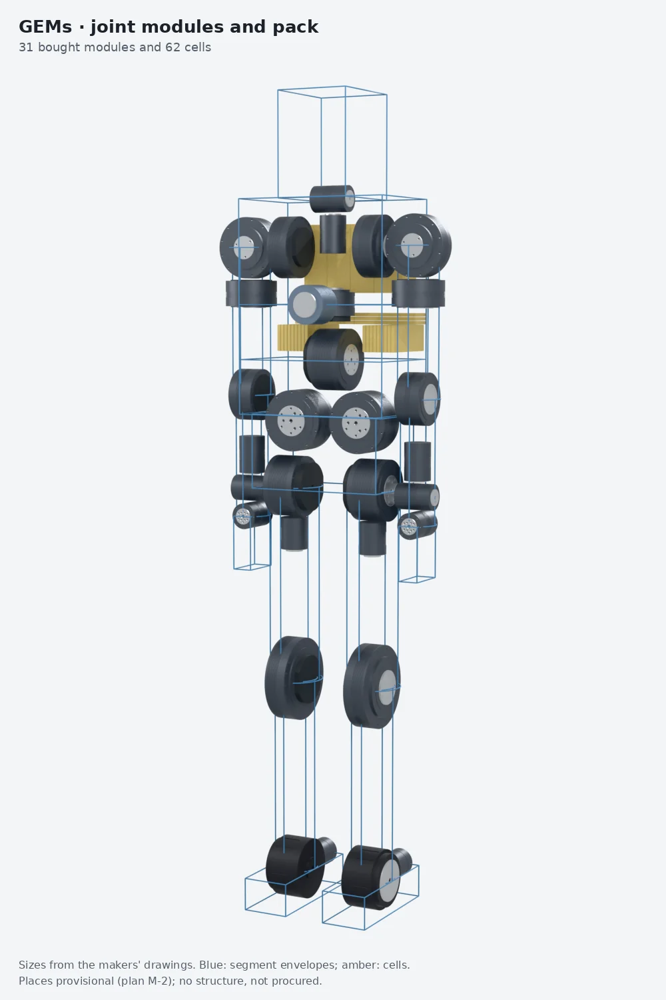

# Joint modules in CAD

The nine joint modules [spec 02.6](../../../spec/02-structure-and-motion.md#the-basis-matters-as-much-as-the-number) declares, drawn from their makers' installation drawings, and a first layout of all 31 on the body — plan [M-1 and M-2](../../../plan/PLAN.md#m--mechanical), 2026-11-24.



| File | Contents |
|---|---|
| [`generate_modules.py`](generate_modules.py) | The modules' dimensions, the layout, the generator in FreeCAD, and the audit |
| `gems-modules.step` | Generated — the nine modules, each as its body, cover and output, in millimetres |
| `gems-module-layout.step` | Generated — the 31 module envelopes in place, facing FreeCAD's *Front* as the [skeleton](../skeleton/README.md#two-frames-one-rotation) does |
| [`layout.csv`](layout.csv) | Generated — where each module sits, how far it stands outside the segment envelopes, how far its joint turns before two modules touch |
| [`render_modules.py`](render_modules.py) | The Blender scene behind the files of `media/` |
| [`pack_fit.py`](pack_fit.py), [`pack.csv`](pack.csv) | How many pouch cells fit in each part of the trunk around the modules, and the reference pack cell by cell; needs numpy |
| `gems-pack.step` | Generated — the 62 cells of the reference pack in place |
| `media/` | `gems-module-layout.glb`, for a viewer on the web; a turntable in WEBM; six stills in WebP |

```bash
python3 hardware/mechanical/modules/generate_modules.py          # build, audit, write
python3 hardware/mechanical/modules/generate_modules.py --check  # build and audit, write nothing
```

Needs FreeCAD 1.1, as the skeleton does. `gems-modules.step` is a drawing of bought parts for layout, not a manufacturing file, and not the makers' own CAD, which was not obtained.

## What is read, and what is not

Diameters, lengths, bolt counts, pitch circles and thread depths are read off the installation drawings: the ENCOS manual V3.13 and MyActuator's XV4 sheet, [electrical refs 35 and 34](../../electrical/README.md#7-references). What the drawings do not print is scaled from them and is illustration: the cooling fins, the angles of the bolt circles, and what each entry of `MODULES` names under `scaled`. SEmotor's sheet prints only the envelope, Φ78 × 65 mm, so everything else of the trunk roll module is illustration. The connectors, the cables and the screws are not drawn.

**The layout is not a design.** Each module lies on its joint's own axis and slides along it until it clears its neighbours, but for hip roll, which stands above its axis and drives it by a parallelogram of rods that is not drawn. The trunk's three sit on the axes of different coupled segments. There is no rod, no bearing and no structure; what a layout this plain is good for is showing what fits.

## Wrist, hip and shoulder, 2026-11-24

The first layout of the day, every module driving its own axis directly, did not fit at three places. Each is changed (Plone):

- **Wrist.** Three Φ53 × 78.5 mm modules cannot share one point: wrist roll stood 69 mm out in front and left 6° of bend toward it. **The pitch axis is now 56 mm above the roll axis** ([kinematics §2](../../kinematics.md#2-reach-and-segment-lengths)), one diameter and the gap, so each axis carries its module, pitch and roll across the limb, yaw along it. The price is that the three axes no longer meet: the arm's inverse kinematics loses the closed form a spherical wrist gives and is solved numerically. Wrist pitch's lever to the grip grows from 60 to 116 mm: 15 kg held level asks it 18.0 Nm, hand and roll module included, within the 20 Nm it is declared at and the 7′00″ its stall table holds that for.
- **Hip roll.** Behind the hip, it stood 90 mm out of the pelvis, and the URDF's thigh, 116 mm across, would have touched it at 7° of extension, against a declared target of 90; the module check alone had said 28, because it does not move the segments. **It is now in the pelvis, above the hip pitch module**, and drives the roll axis, 136 mm below, by a parallelogram whose ratio is 1: for 185 Nm, two rods on 45 mm cranks carry about 2.1 kN each at the middle of the travel and 2.9 at 45°. The rods and rod ends are to be bought, the cranks are GEMs' own integration; none is drawn.
- **Shoulder.** The joint stood level with the base of the neck, 1.446 m up, and its modules 62 mm above the torso. Women of 1.63–1.67 m in [ANSUR II](https://www.openlab.psu.edu/ansur2/) have the acromion at 1.353 m (442 of 1986; the female file). **The shoulders are now at 1.35 m** ([kinematics §2](../../kinematics.md#2-reach-and-segment-lengths)); nothing stands above the torso or beside the head, and the wrist hangs at 0.80 m, where the same file has 0.805. Reach overhead drops by 95 mm.

The trunk's modules were rearranged to make room: pitch on the middle segment's axis, yaw and roll on the upper's.

## What it shows

In the zero pose no two modules overlap. Turned alone, **two modules stop 5 of the 31 joints** before the end of their mechanical travel, against 18 of 28 in the first layout, which did not check the trunk:

- **Hip roll** (both): inward 6°, where the two ankle modules meet, and outward 22°, where the hip pitch module meets the wrist of an arm hanging straight down. Without the arms and the other leg its whole travel is clear.
- **Shoulder roll** (both): the same wrist against the same hip, an arm hanging straight down cannot turn inward.
- **Trunk bend**: 2° for the hanging arms, and **21° without them, where hip roll meets trunk pitch** — below the 30° of the human range and the 45 that is the provisional target. This one is the layout's, and open.

Outside the segment envelopes:

| Module | Outside, mm | Against women of 1.63–1.67 m (ANSUR II, means) |
|---|---|---|
| Shoulder roll | 54, at the side | modules 504 mm across; shoulder breadth over the deltoids 452 |
| Knee, Φ170 | 41 | lower thigh 129 mm across, calf 120 |
| Ankle roll / pitch | 30 / 22 | ankle 69 mm across |
| Trunk roll | 20, in front | chest depth 249, the module's front at 120 mm from the middle |
| Elbow, Φ105 | 19 | upper arm 98 mm across, forearm 85 |
| Hip pitch | 14 | hip breadth 356; the modules 265 |
| Wrist pitch / roll, shoulder yaw | 9 / 9 / 8 | wrist 50 mm across |

Part of each figure is the URDF's, whose segments are thinner than a person's: a thigh of 116 mm where the file's circumference gives 197 at the top, a shank of 94 against 120. The widths across are circumference over π. What is wide in itself is the shoulder, the knee and the ankle.

The check turns one joint at a time, in steps of 2°, with plain cylinders for the modules and nothing else of the body — no segment, no rod, no pack — so a clear figure is not a promise. The shoulder pitch modules stand where the battery pack lies, in the upper back; how the pack goes round them is [below](#the-reference-pack-2026-11-24).

## Room for the pack

Where cells fit around the modules, counted by [`pack_fit.py`](pack_fit.py) with the two pouch cells nearest the durable tier in Amprius's Q4 2026 catalogue ([electrical §3](../../electrical/README.md#3-power)).

| Part of the trunk, back at x | Free | SA147, preliminary | SA03 |
|---|---|---|---|
| Upper torso, −100 mm, the envelope | 4.1 L | 99 cells, 1.49 kWh | 33, 1.33 kWh |
| Upper torso, −125 | 5.3 L | 164, 2.46 | 41, 1.65 |
| Upper torso, −150 | 6.4 L | 192, 2.88 | 54, 2.17 |
| Upper torso, −180 | 7.8 L | 261, 3.92 | 78, 3.14 |
| Lower thoracic, −125 | 4.2 L | 128, 1.92 | 36, 1.45 |
| Lumbar, −125 | 4.1 L | 107, 1.60 | 26, 1.05 |
| Pelvis, −125 | 4.9 L | 133, 2.00 | 29, 1.17 |

Cells are boxes at their largest tolerance with 0.5 mm between faces. Nothing is kept for terminals, compression, cooling, the crush zone or the vent path, so a real pack holds less; how much less is not sourced. The fill is a greedy one, so a better lattice holds somewhat more.

## The reference pack, 2026-11-24

At 12 W/kg the reference asks 2.46 kWh ([electrical §6m](../../electrical/README.md#6m-specific-power-the-cell-and-the-modules-margin--2026-11-24)): 61 SA03 cells, **62 placed**, 2.50 kWh, 6.3 kg of cells, **38 in the upper back and 24 in the lower thoracic segment** (Plone: not in the pelvis), the left half mirrored, 3 mm of wall on every side, cell by cell in [`pack.csv`](pack.csv).

- **The back is at x = −150 mm**, a trunk 250 mm deep before the shell, where women of 1.63–1.67 m have a chest of 249 mm (206–297, 5th to 95th percentile) and a waist of 214 (169–276) in ANSUR II. There the symmetric fill holds 74 cells, so 62 are 84% of it; at −140 mm it holds 68, 91%; at −160, 90, 69%. The earlier estimate of 72% was at −125 mm without walls, symmetry or the neck's sweep.
- **The audit**: 62 cells, none overlapping, none inside a module, left mirroring right. Turned alone, the trunk's pitch and yaw, the neck, the shoulder and the hip clear the cells through their whole travel with 3 mm kept; trunk bend clears to 36°, past where the modules stop it.
- **What is not drawn**: the boxes, terminals and busbars; the 15 PSI of compression the maker recommends; cooling; the crush zone and the vent path, down and away from the body; the cable between the two boxes, across the trunk's coupled joint. **Whether the 12 to 16% left is enough for them is not shown.**
- **The series count is D-4's.** SA03 is 3.4 V nominal, 2.5–4.2: 62 cells are not a rectangle of series and parallel, and the modules' 48 V, the fan's 28–53 V and 4.2 V a cell pull against one another — 12 in series is 40.8 V and 50.4 full, 14 is 47.6 and 58.8.
- **The compute, the converters and the battery management are not placed.**
